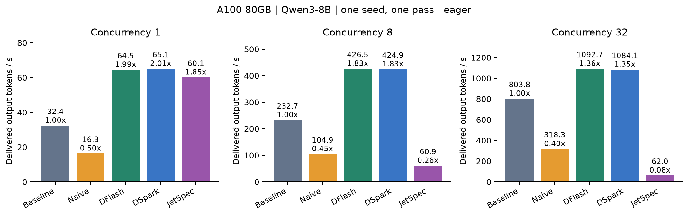

# NanoSpec

A small teaching engine for speculative decoding on the original **nano-vLLM**.
Select `none`, `naive`, `dflash`, `dspark`, or `jetspec` when constructing the engine.

**Measured on one A100 80GB:** all 15 performance cells and five separate PyTorch profiles completed.
The results compare these implementations under one controlled workload, with **one seed and one pass**.

[English report](reports/a100-20261118/RESULTS.md) · [中文报告](reports/a100-20261118/RESULTS.zh-CN.md) ·
[All tables](reports/a100-20261118/TABLES.md) · [CSV](reports/a100-20261118/metrics.csv) ·
[Profiling data](reports/a100-20261118/profiling) · [Tutorial](docs/TUTORIAL.md)

## Measured throughput

| Method | C=1 tok/s (speedup) | C=8 tok/s (speedup) | C=32 tok/s (speedup) |
|---|---|---|---|
| Baseline | 32.41 (1.00x) | 232.74 (1.00x) | 803.81 (1.00x) |
| Naive | 16.33 (0.50x) | 104.86 (0.45x) | 318.29 (0.40x) |
| DFlash | 64.53 (1.99x) | 426.52 (1.83x) | 1092.74 (1.36x) |
| DSpark | 65.12 (2.01x) | 424.92 (1.83x) | 1084.13 (1.35x) |
| JetSpec | 60.10 (1.85x) | 60.93 (0.26x) | 62.03 (0.08x) |



Qwen3-8B BF16; 128 SPEED-Bench requests per cell; 256 output tokens ignoring EOS; eager execution;
closed-loop concurrency 1/8/32; seed 29. Speedup is paired with the baseline at the same concurrency.
These are single observations, not confidence intervals. DFlash and DSpark are close; Naive is slower here.
JetSpec uses a simple per-request tree verifier, which limits its concurrent throughput.

## Methods

| Switch | Draft | Verification | Implementation |
|---|---|---|---|
| `none` | None | One target token | Original nano FlashAttention path |
| `naive` | Independent Qwen3-0.6B | Chain with p/q rejection sampling | Sequential draft, batched target verification |
| `dflash` | DeepSpec block7 head | Chain with rejection sampling | Parallel block proposal |
| `dspark` | DeepSpec Markov block7 head | Corrected draft distribution | Sequential Markov correction |
| `jetspec` | Original JetSpec causal head | Ancestor-masked candidate tree | Independent implementation; eager SDPA, one tree per request |

JetSpec's stochastic path uses target-distribution traversal, rather than reproducing the paper's
non-greedy rejection protocol. This is **original JetSpec, not JetSpec++**, and is not an optimized official runtime.
The baseline is this project's non-speculative engine path, not a separate untouched upstream binary.
See [source boundaries and attribution](docs/UPSTREAM.md) and [NOTICE](NOTICE.md).

## Install and choose a method

Use Linux and Python 3.10–3.12 with a CUDA-compatible PyTorch, Triton and FlashAttention 2 installation.
The [recorded runtime](reports/a100-20261118/environment/pip-freeze.txt) is the source of truth for the measured run.

```bash
pip install -e .
pip install 'triton>=3' 'flash-attn>=2.7' --no-build-isolation
python tools/download_models.py --out models
python example.py --target models/Qwen3-8B --method naive --draft models/Qwen3-0.6B --k 7
python example.py --target models/Qwen3-8B --method dflash --draft models/dflash_qwen3_8b_block7
python example.py --target models/Qwen3-8B --method dspark --draft models/dspark_qwen3_8b_block7
python example.py --target models/Qwen3-8B --method jetspec --draft models/jetspec-qwen3-8b
```

```python
from nanovllm import LLM, SamplingParams

llm = LLM(
    "models/Qwen3-8B",
    method="dspark",  # none / naive / dflash / dspark / jetspec
    draft_model="models/dspark_qwen3_8b_block7",
    enable_prefix_cache=False,
    kv_cache_memory_bytes=16 << 30,
    max_num_seqs=8,
    enforce_eager=True,
    seed=29,
)
try:
    print(llm.generate(["Explain speculative decoding."], SamplingParams(temperature=0.7))[0]["text"])
finally:
    llm.exit()
```

Naive additionally requires a separate `draft_kv_cache_memory_bytes` budget and uses `num_speculative_tokens`.
Block7 heads fix the draft length at seven. JetSpec exposes `jetspec_tree_budget` and `jetspec_tree_width`.
Method selection happens at engine construction, not per request.

## Benchmark and profiling

See [the CSF runbook](docs/CSF.md) for the direct 15-cell matrix and separate five-method profiles.
The workflow does not launch preflight experiments or correctness tests.

- [Benchmark definitions](docs/BENCHMARK.md): wall/steady throughput, TTFT, TPOT, delivery gaps, goodput, KV and memory.
- [Profiling guide](docs/PROFILING.md): traces, operators, phase event timing, and optional Nsight commands.
- [Measured report](reports/a100-20261118/RESULTS.md): phase tables, kernel analysis and diagnostic timelines.

GPU telemetry failed in this run; no measured power, hardware utilization, occupancy or HBM bandwidth is claimed.
The exact frozen input panel was not included in the downloaded result archive; its hash and selection recipe are recorded.
Do not substitute the shipped 16-prompt example panel and call it the measured workload.

## Repository layout

```text
nanovllm/                    Small inference engine, model heads and speculative decoders
benchmarks/                  Workload driver, metrics and profiling instrumentation
bench_spec.py                Performance matrix entry point
profile_spec.py              Separate diagnostic profiling entry point
scripts/                     Direct CSF/native/container launchers
tools/                       Model download, input preparation, report builder and optional checks
tests/                       Existing standalone correctness suite; not run automatically on push
docs/                        Tutorial, protocols, launch instructions and source attribution
reports/a100-20261118/        Bilingual reports, tables, figures and published measurement evidence
```

Regenerate figures and tables from committed measurements without a GPU:

```bash
pip install matplotlib
python tools/build_reports.py
```

Model weights, caches and generated output token IDs are excluded. Cluster account paths and GPU UUID are redacted.
Timing values are preserved. Compressed event records and traces are committed so the report can be inspected offline.

## License and credit

MIT; see [LICENSE](LICENSE), [NOTICE](NOTICE.md), [third-party licenses](licenses) and [provenance](provenance.json).
Built on [GeeeekExplorer/nano-vllm](https://github.com/GeeeekExplorer/nano-vllm) and the early integration in
[tianyuantong/nano-vllm-speculative-decoding](https://github.com/tianyuantong/nano-vllm-speculative-decoding).
Model checkpoints retain their own terms.
