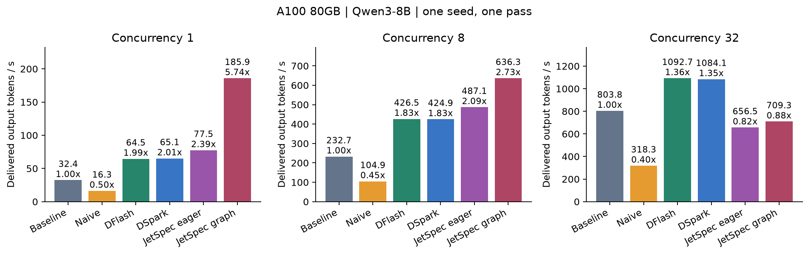
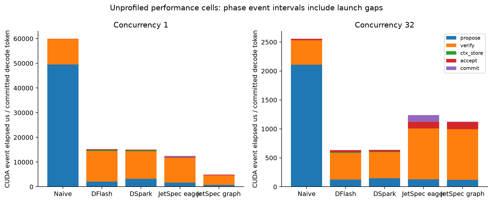
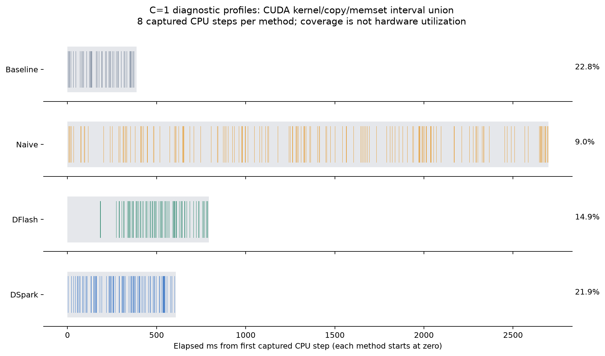

# NanoSpec: single-A100 results and profiling

[中文报告](RESULTS.zh-CN.md) · [Tables](TABLES.md) · [Performance CSV](metrics.csv) · [Profiling CSV](profiling.csv)

## Findings

DFlash and DSpark deliver about **2.0x** baseline throughput at C=1, **1.83x** at C=8,
and **1.35x** at C=32. Their small differences are not a reliable ranking from a single run.
Naive reaches 0.40–0.50x baseline throughput. Batched Triton JetSpec runs 14–20% faster than eager DFlash and DSpark at C=1 and C=8. With CUDA Graphs, it reaches **185.89** and **636.31** tokens/s at those concurrencies. At C=32 it delivers **709.31** tokens/s, about 35% below DFlash and DSpark.

## Execution and protocol

JetSpec ran in CSF job **24896042** on node854 with one A100-SXM4-80GB. It exited with code 0:0 after 23 min 32 s, completing six performance cells and four diagnostic profiles. Baseline, Naive, DFlash and DSpark come from job **24846937**, including three compatible reused cells, on another A100 of the same model. Both jobs used the same frozen inputs and sampling settings, with one seed and one pass per cell.

| Setting | Measured configuration |
|---|---|
| Target | Qwen3-8B BF16, tensor parallel size 1 |
| Workload | 128 unique first-turn SPEED-Bench throughput_1k prompts, SHA256 ordering, CJK excluded |
| Input formatting | Qwen3 non-thinking chat template, frozen token IDs |
| Load | Closed-loop concurrency 1 / 8 / 32, immediate refill |
| Output | 256 tokens per request, EOS ignored; 32,768 output tokens per performance cell |
| Sampling | Seed 29; one pass; temperature 0.7 / top-k 20 / top-p 0.8 |
| Execution | JetSpec measured with eager and forward CUDA Graphs; all other methods eager; speculative prefix caching disabled |
| Draft settings | Naive k=7; DFlash/DSpark block7; JetSpec budget=32, width=4 |
| KV budgets | Target 16 GiB for every method; additional Naive draft 8 GiB |
| Limits | max_model_len=4096; max_num_batched_tokens=16384 |
| Runtime | Python 3.11.8; PyTorch 2.11.0+cu128; Transformers 4.57.6; FlashAttention 2.8.3; Triton 3.6.0 |
| Profiles | JetSpec eager and graph at C=1 and C=32; other methods at C=1; eight captured steps per trace |

The actual run used a native system-site-packages venv borrowing an existing GPU environment, not the proposed
container image. See [pip freeze](environment/pip-freeze.txt), [GPU metadata](environment/nvidia-smi.txt),
[run log](run.log) and [execution record](data/run.json).

### Model revisions

| Role | Checkpoint | Revision |
|---|---|---|
| target | Qwen/Qwen3-8B | `b968826d9c46dd6066d109eabc6255188de91218` |
| naive | Qwen/Qwen3-0.6B | `c1899de289a04d12100db370d81485cdf75e47ca` |
| dflash | deepseek-ai/dflash_qwen3_8b_block7 | `9e44dbbb6cb68b0c943abf9c5fc3c17c00897cdf` |
| dspark | deepseek-ai/dspark_qwen3_8b_block7 | `03326e5043815da1f81b109078b2889737c26017` |
| jetspec | JetSpec/jetspec-qwen3-8b | `020a198caefde24a2891ad827cba7fb977ccdc36` |

## End-to-end throughput

| Method | C=1 tok/s (speedup) | C=8 tok/s (speedup) | C=32 tok/s (speedup) |
|---|---|---|---|
| Baseline | 32.41 (1.00x) | 232.74 (1.00x) | 803.81 (1.00x) |
| Naive | 16.33 (0.50x) | 104.86 (0.45x) | 318.29 (0.40x) |
| DFlash | 64.53 (1.99x) | 426.52 (1.83x) | 1092.74 (1.36x) |
| DSpark | 65.12 (2.01x) | 424.92 (1.83x) | 1084.13 (1.35x) |
| JetSpec eager | 77.48 (2.39x) | 487.08 (2.09x) | 656.49 (0.82x) |
| JetSpec graph | 185.89 (5.74x) | 636.31 (2.73x) | 709.31 (0.88x) |



Wall throughput is delivered output tokens divided by the measured host workload interval, including prefill,
scheduling and drain; it excludes model initialization, warmup and text detokenization. Ratios are paired by
concurrency and workload. The shared engine and benchmark hashes were checked when reusing cells.

## Infrastructure measurements

| C | Method | Steady tok/s | TTFT p50/p99 ms | Latency p50/p99 ms | TPOT p50 ms | Gap p99 ms | Goodput req/s | Peak alloc GiB |
|---|---|---|---|---|---|---|---|---|
| 1 | Baseline | 32.41 | 76.93/89.74 | 7789.16/8434.61 | 30.24 | 38.20 | 0.125 | 31.42 |
| 1 | Naive | 16.33 | 105.20/374.65 | 14675.23/24487.69 | 57.14 | 218.38 | 0.000 | 40.55 |
| 1 | DFlash | 64.54 | 79.04/91.53 | 3950.28/7509.40 | 15.18 | 44.66 | 0.250 | 38.00 |
| 1 | DSpark | 65.13 | 76.81/88.71 | 3787.25/7763.49 | 14.56 | 48.02 | 0.252 | 38.15 |
| 1 | JetSpec eager | 77.49 | 74.94/85.14 | 3401.03/5803.82 | 13.05 | 41.80 | 0.300 | 35.68 |
| 1 | JetSpec graph | 185.97 | 75.59/85.85 | 1417.16/2374.89 | 5.27 | 16.83 | 0.720 | 35.70 |
| 8 | Baseline | 233.53 | 508.13/544.55 | 8807.85/8885.92 | 32.54 | 35.52 | 0.909 | 32.22 |
| 8 | Naive | 108.55 | 103.91/552.30 | 18246.79/29081.56 | 71.15 | 342.60 | 0.000 | 41.30 |
| 8 | DFlash | 448.52 | 75.46/509.37 | 4598.90/8631.79 | 17.49 | 118.59 | 0.026 | 39.03 |
| 8 | DSpark | 443.65 | 75.64/511.14 | 4609.27/8950.32 | 17.79 | 125.90 | 0.039 | 39.17 |
| 8 | JetSpec eager | 497.48 | 75.78/504.68 | 4368.47/6129.11 | 16.83 | 120.77 | 0.030 | 36.81 |
| 8 | JetSpec graph | 644.91 | 76.59/506.49 | 3339.47/4786.64 | 12.51 | 110.71 | 0.039 | 36.83 |
| 32 | Baseline | 845.89 | 1899.81/2068.94 | 10187.53/10209.94 | 32.48 | 33.06 | 0.000 | 32.99 |
| 32 | Naive | 382.92 | 105.88/2281.42 | 21446.84/32897.76 | 82.36 | 399.00 | 0.000 | 42.11 |
| 32 | DFlash | 1298.15 | 134.84/2075.87 | 6549.54/13299.60 | 24.27 | 194.21 | 0.067 | 40.12 |
| 32 | DSpark | 1315.33 | 78.19/2072.27 | 6293.20/12750.78 | 23.02 | 196.27 | 0.033 | 40.27 |
| 32 | JetSpec eager | 742.23 | 133.37/2051.97 | 11552.31/20703.10 | 43.13 | 310.55 | 0.000 | 39.39 |
| 32 | JetSpec graph | 748.31 | 133.53/2058.89 | 11052.57/20549.89 | 41.25 | 254.89 | 0.000 | 38.14 |

Each latency percentile comes from 128 requests in that cell. TTFT includes initial scheduling delay;
TPOT is `(last delivery - first delivery)/(output tokens - 1)`. A speculative round can deliver several tokens
at once, so delivery gap differs from TPOT. Steady throughput uses the bounded full-concurrency interval before
drain; it is not the end-to-end numerator or denominator used for speedup.

Goodput counts requests satisfying **all** of TTFT <= 1000 ms, TPOT <= 50 ms and **maximum** delivery gap <= 100 ms.
This is a workload-specific threshold, not a production SLO recommendation. DFlash/DSpark throughput gains do
not automatically translate into higher goodput: at C=8 the baseline has much shorter delivery gaps.
At C=32 the initial cohort has approximately 2-second TTFT tails. Peak allocated memory is PyTorch allocation,
not total device framebuffer use; reserved memory is provided separately in [metrics.csv](metrics.csv).

### Acceptance, verification work and KV

| C | Method | Accepted/proposed | Committed tokens/sequence round | Verified positions/committed token | Target KV peak % | Preemptions |
|---|---|---|---|---|---|---|
| 1 | Baseline | N/A | 1.000 | N/A | 1.32 | 0 |
| 1 | Naive | 0.320 | 3.215 | 2.488 | 1.32 | 0 |
| 1 | DFlash | 0.255 | 2.771 | 2.887 | 1.32 | 0 |
| 1 | DSpark | 0.299 | 3.069 | 2.607 | 1.32 | 0 |
| 1 | JetSpec eager | 0.072 | 3.222 | 9.931 | 1.54 | 0 |
| 1 | JetSpec graph | 0.072 | 3.222 | 9.931 | 1.54 | 0 |
| 8 | Baseline | N/A | 1.000 | N/A | 10.33 | 0 |
| 8 | Naive | 0.321 | 3.220 | 2.485 | 9.67 | 0 |
| 8 | DFlash | 0.243 | 2.682 | 2.982 | 9.67 | 0 |
| 8 | DSpark | 0.286 | 2.981 | 2.684 | 9.67 | 0 |
| 8 | JetSpec eager | 0.070 | 3.155 | 10.143 | 10.11 | 0 |
| 8 | JetSpec graph | 0.070 | 3.156 | 10.140 | 10.11 | 0 |
| 32 | Baseline | N/A | 1.000 | N/A | 39.34 | 0 |
| 32 | Naive | 0.305 | 3.111 | 2.571 | 37.14 | 0 |
| 32 | DFlash | 0.235 | 2.632 | 3.039 | 36.92 | 0 |
| 32 | DSpark | 0.284 | 2.967 | 2.697 | 37.14 | 0 |
| 32 | JetSpec eager | 0.070 | 3.139 | 10.195 | 38.24 | 0 |
| 32 | JetSpec graph | 0.070 | 3.145 | 10.174 | 38.24 | 0 |

Accepted/proposed has different denominators for a chain and a candidate tree. JetSpec can propose many nodes
that are never on the accepted path, so its ratio is not directly comparable to chain acceptance. Committed
tokens/sequence round counts actual post-truncation output. Verified positions/committed token exposes target
work amplification. No preemptions or recomputed tokens were recorded in these 18 cells; this workload did not
stress KV exhaustion. KV peak is occupied target blocks / reserved target block capacity, not HBM utilization.

## CUDA phase timing from performance cells

| C | Method | propose us/token | verify us/token | ctx_store us/token | accept us/token | commit us/token |
|---|---|---|---|---|---|---|
| 1 | Naive | 49511.67 | 10284.51 | N/A | 154.20 | 17.52 |
| 1 | DFlash | 2130.20 | 12266.19 | 455.21 | 329.08 | 30.30 |
| 1 | DSpark | 3204.13 | 11151.90 | 406.37 | 294.42 | 26.75 |
| 1 | JetSpec eager | 1681.63 | 10146.08 | N/A | 175.92 | 466.79 |
| 1 | JetSpec graph | 783.26 | 3851.46 | N/A | 176.49 | 106.31 |
| 32 | Naive | 2108.68 | 420.07 | N/A | 28.87 | 0.65 |
| 32 | DFlash | 123.59 | 461.61 | 11.10 | 34.95 | 0.79 |
| 32 | DSpark | 144.03 | 452.48 | 10.58 | 31.24 | 0.77 |
| 32 | JetSpec eager | 128.05 | 877.78 | N/A | 114.59 | 118.07 |
| 32 | JetSpec graph | 121.01 | 874.52 | N/A | 119.45 | 10.10 |



These CUDA event intervals come from the **unprofiled performance run**, normalized by committed decode tokens.
They include device idle gaps between launches and therefore are not pure kernel time. Phases omit prefill and
some host bookkeeping; they must not be used as an additive end-to-end latency breakdown.
For display, JetSpec `propose_tree/verify_tree/accept_tree/commit_tree` map to propose/verify/accept/commit;
chain commit is `commit_copy`. Context storage is separate only where instrumented; N/A is not zero cost.
The exact original phase names and distributions remain in each cell JSON.

Naive proposal dominates its event cost: seven sequential small-model draft steps are expensive in this eager
implementation. DFlash and DSpark reduce that proposal cost substantially. At C=32, JetSpec commits about 3.15 tokens per sequence round, compared with 2.97 for DSpark and 2.63 for DFlash. It verifies 10.17 positions per delivered token, versus 2.70 and 3.04, respectively. Verification remains the largest JetSpec phase at about 875 µs per output token with graphs.

## Separate PyTorch profiling

| Method | CPU steps | Window ms | Kernel launches | Kernel sum ms | Device interval union ms | Coverage % | Memcpy events | Host sync ms |
|---|---|---|---|---|---|---|---|---|
| Baseline | 8 | 387.30 | 4448 | 88.02 | 88.48 | 22.85 | 88 | 0.03 |
| Naive | 8 | 2698.01 | 30454 | 241.54 | 242.55 | 8.99 | 383 | 0.05 |
| DFlash | 8 | 792.72 | 5568 | 117.35 | 117.73 | 14.85 | 176 | 0.04 |
| DSpark | 8 | 607.18 | 8096 | 131.81 | 132.78 | 21.87 | 392 | 0.04 |
| JetSpec eager C=1 | 8 | 636.88 | 5936 | 129.01 | 129.42 | 20.32 | 128 | 0.03 |
| JetSpec eager C=32 | 8 | 883.95 | 5591 | 843.87 | 850.05 | 96.16 | 112 | 0.06 |
| JetSpec graph C=1 | 8 | 137.94 | 5936 | 126.67 | 126.76 | 91.90 | 128 | 0.05 |
| JetSpec graph C=32 | 8 | 866.09 | 5595 | 843.91 | 849.59 | 98.09 | 112 | 0.20 |



All eight traces contain eight captured **CPU** steps; full diagnostic workloads continue beyond the captured
window. Kernel counts and summed kernel durations count only Chrome-trace `kernel` events. Device interval union
merges `kernel`, `gpu_memcpy` and `gpu_memset` events clipped to the CPU capture window; coverage divides that union
by the window duration. This is **trace activity coverage, not nvidia-smi utilization, SM occupancy, efficiency,
or HBM bandwidth**. The instrumented windows have large overhead and different accepted output counts, so their
durations cannot replace the unprofiled speedup table. Kernel sums can overlap across streams.

At C=1, JetSpec eager and graph both execute 5,936 GPU kernels with roughly 129 ms and 127 ms of summed kernel time, respectively. Graph replay reduces direct `cudaLaunchKernel` calls from 2,848 to 1,072. At C=32, both modes spend about 844 ms in GPU kernels in the captured window. The traces are consistent with host submission savings dominating at low concurrency and leaving less room for improvement at high concurrency.

### Largest kernels in each capture

| Method | Top kernel (name shortened) | Calls | Kernel ms |
|---|---|---|---|
| Baseline | `ampere_bf16_s16816gemm_bf16_128x64_ldg8_f2f_stages_32x6_tn` | 288 | 34.40 |
| Baseline | `ampere_bf16_s16816gemm_bf16_64x64_sliced1x2_ldg8_f2f_stages_64x6_tn` | 576 | 25.76 |
| Baseline | `void cutlass::Kernel2<cutlass_80_tensorop_bf16_s16816gemm_relu_bf16_64x64_64x6_tn_align8>(` | 288 | 9.40 |
| Naive | `ampere_bf16_s16816gemm_bf16_128x64_ldg8_f2f_stages_64x3_tn` | 288 | 34.20 |
| Naive | `ampere_bf16_s16816gemm_bf16_64x64_ldg8_f2f_stages_64x5_tn` | 1708 | 29.18 |
| Naive | `ampere_bf16_s16816gemm_bf16_64x64_sliced1x2_ldg8_f2f_stages_64x6_tn` | 576 | 26.19 |
| DFlash | `ampere_bf16_s16816gemm_bf16_128x64_ldg8_f2f_stages_64x3_tn` | 328 | 38.85 |
| DFlash | `ampere_bf16_s16816gemm_bf16_64x64_sliced1x2_ldg8_f2f_stages_64x6_tn` | 656 | 29.88 |
| DFlash | `ampere_bf16_s16816gemm_bf16_64x64_sliced1x2_ldg8_f2f_stages_64x5_tn` | 352 | 22.96 |
| DSpark | `ampere_bf16_s16816gemm_bf16_128x64_ldg8_f2f_stages_64x3_tn` | 328 | 38.69 |
| DSpark | `ampere_bf16_s16816gemm_bf16_64x64_sliced1x2_ldg8_f2f_stages_64x6_tn` | 656 | 29.69 |
| DSpark | `ampere_bf16_s16816gemm_bf16_64x64_sliced1x2_ldg8_f2f_stages_64x5_tn` | 352 | 22.85 |
| JetSpec eager C=1 | `ampere_bf16_s16816gemm_bf16_256x64_ldg8_f2f_stages_64x3_tn` | 584 | 61.43 |
| JetSpec eager C=1 | `ampere_bf16_s16816gemm_bf16_64x64_sliced1x2_ldg8_f2f_stages_64x6_tn` | 656 | 21.31 |
| JetSpec eager C=1 | `_attention` | 288 | 14.72 |
| JetSpec eager C=32 | `ampere_bf16_s16816gemm_bf16_256x128_ldg8_f2f_stages_64x3_tn` | 1321 | 519.74 |
| JetSpec eager C=32 | `_attention` | 288 | 102.12 |
| JetSpec eager C=32 | `ampere_bf16_s16816gemm_bf16_128x256_ldg8_f2f_stages_64x3_tn` | 16 | 55.68 |
| JetSpec graph C=1 | `ampere_bf16_s16816gemm_bf16_256x64_ldg8_f2f_stages_64x3_tn` | 584 | 60.71 |
| JetSpec graph C=1 | `ampere_bf16_s16816gemm_bf16_64x64_sliced1x2_ldg8_f2f_stages_64x6_tn` | 656 | 20.88 |
| JetSpec graph C=1 | `_attention` | 288 | 14.72 |
| JetSpec graph C=32 | `ampere_bf16_s16816gemm_bf16_256x128_ldg8_f2f_stages_64x3_tn` | 1322 | 520.52 |
| JetSpec graph C=32 | `_attention` | 288 | 102.38 |
| JetSpec graph C=32 | `ampere_bf16_s16816gemm_bf16_128x256_ldg8_f2f_stages_64x3_tn` | 16 | 55.76 |

Full names, call counts and durations are in [JetSpec evidence](data/jetspec.json) and the other methods’ `summary.json` files; original operator summaries are also
preserved. **Do not sum nested annotations or use the original operator table's percentages as utilization**:
PyTorch reports overlapping target/draft/round annotations, sometimes with percentages above 100%.
The tables above aggregate kernel events directly to avoid that double counting.

### Capture limitations

- All eight diagnostic profiles report complete capture and an exported trace.
- GPU telemetry is empty for job 24846937: the UUID passed to nvidia-smi lacked its `GPU-` prefix, and nvidia-smi exited with code 6.
  The failure is preserved, not filled with invented samples. No power/energy or hardware-utilization comparison is available.
- Nsight Systems/Compute were not run. Achieved SM occupancy, DRAM GB/s and hardware-counter comparisons are unavailable.
- The profiler warning about clearing cycles is retained in the log. The exported active-cycle trace is the evidence;
  the final post-cycle operator summary should not be interpreted as a whole-workload profile.

## Scope and reproducibility

One seed and one pass provide descriptive observations only: there are no error bars, repeated-run variance or
statistical-significance claims. Actual BF16 checkpoint execution completed, but these benchmarks are not a
real-weight numerical-parity or output-quality validation.

The reference project used different hardware and protocol choices, including CUDA Graphs, its frozen stratified
panel, a 512-token EOS-stopping limit and additional concurrency/seed settings. This A100 run is not a replication
of that project's published speedup table. The Naive draft length here is seven; its early implementation used three.

The input panel SHA256 is `ec077675b6a2ce08dc99e7bd2e61796d742ee7d987678462335799e0003ffccd2`.
The frozen panel and metadata were absent from the downloaded archive, so this publication does **not** contain
everything needed for an exact input replay. `tools/prepare_panel.py` records the selection recipe; downloading
the original panel and its metadata from CSF is required before claiming exact replay. The 16-prompt example
panel is a different workload.

Each cell records the measured engine and benchmark hashes. See [JetSpec measurement data](data/jetspec.json) and the [archived benchmark entry point](environment/bench_spec.measured.py) for job 24846937.

## Evidence layout and report generation

- `data/jetspec.json` contains six JetSpec performance cells, source hashes and four profiling summaries.
- `data/cells/` contains the original comparison job records with settings, metrics, distributions and hashes.
- `data/events/`: compressed request, host-step, CUDA-step and phase records; timing values preserved.
- `profiling/<method>/`: redacted compressed trace, operators, capture status, diagnostic result and derived summary.
- `environment/`: runtime freeze and GPU metadata; `data/original-sha256.json` hashes the downloaded source files.
- Private account paths and GPU UUID are replaced with placeholders. Generated output token IDs are omitted.
  The original local archive remains the unmodified evidence copy.

```bash
pip install matplotlib
python tools/build_reports.py
python -c "import gzip,pathlib; p=pathlib.Path('reports/a100-20261118/profiling/dspark/trace.json.gz'); pathlib.Path('dspark.trace.json').write_bytes(gzip.decompress(p.read_bytes()))"
```

Load the decompressed trace in a Chrome-trace-compatible viewer. The report builder reads committed data and
starts no model, GPU job or new experiment. Source and third-party attribution are in [NOTICE](../../NOTICE.md).
