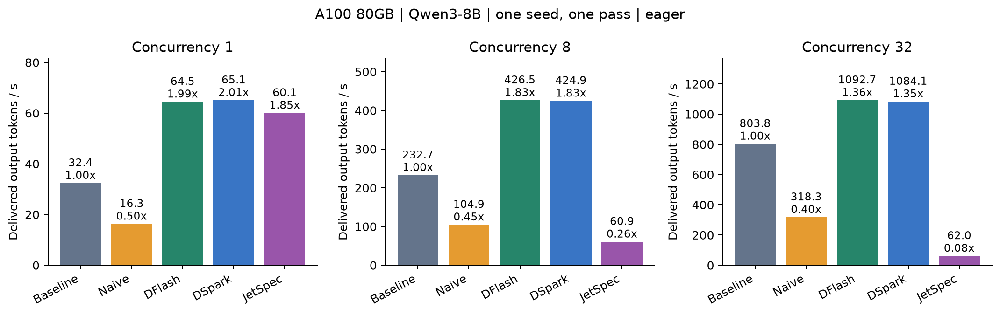
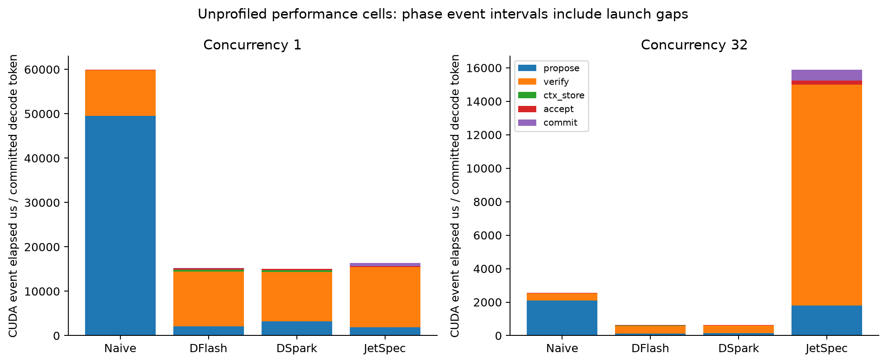
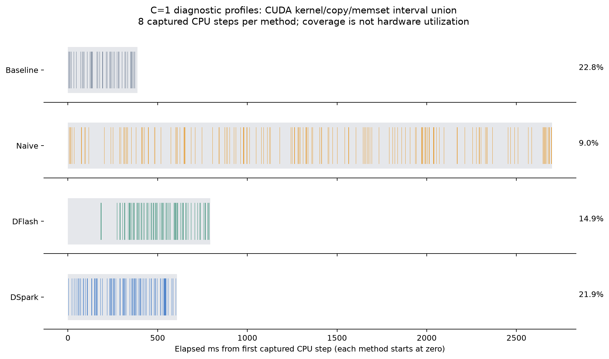

# NanoSpec：单张 A100 性能与 Profiling 报告

[English report](RESULTS.md) · [完整表格](TABLES.md) · [性能 CSV](metrics.csv) · [Profiling CSV](profiling.csv)

## 主要结论

DFlash、DSpark 在并发 1 时约为 baseline 的 **2.0 倍**，并发 8 时约 **1.83 倍**，并发 32 时约 **1.35 倍**。
两者差距很小，单次运行不足以确定稳定排名。Naive 在这套 eager 实现下起草成本超过收益，只有 baseline 的 0.40–0.50 倍吞吐。
独立实现的 JetSpec 在并发 1 时有 1.85 倍加速，但并发提高后总吞吐仍约 60–62 token/s，主要受逐请求树处理方式限制。
这份报告比较的是本项目的具体实现，不是论文算法的性能排名。

## 实际运行与实验设置

CSF 作业 **24846937** 已完成，退出码 **0:0**，耗时 **02:14:04**，使用一张 NVIDIA A100-SXM4-80GB。
结果包含 15 组成功的性能运行，以及五种方法各一次独立的诊断 profiling。
缩减原矩阵后复用了作业 24846564 中三组完全兼容的结果：baseline C=32、DFlash C=8、baseline C=8。
最终每个“方法 × 并发”只纳入一个观测；原始记录中的 `repeat=1` 是保留的轮次索引，不表示额外再跑一次。

| 设置 | 实际配置 |
|---|---|
| Target | Qwen3-8B，BF16，单卡 TP=1 |
| 输入 | SPEED-Bench throughput_1k 的 128 条唯一首轮输入，按 SHA256 排序，排除 CJK |
| 模板 | Qwen3 非思考聊天模板，冻结后的 token IDs |
| 负载 | 闭环并发 1 / 8 / 32，请求完成后立即补充 |
| 输出 | 每请求固定 256 token，忽略 EOS；每组共 32,768 token |
| 采样 | seed=29，每组一次；temperature=0.7，top-k=20，top-p=0.8 |
| 执行 | 五种路径统一 eager，关闭投机 prefix cache |
| 起草 | Naive k=7；DFlash/DSpark block7；JetSpec 树预算 32、宽度 4 |
| KV | 所有方法 target 16 GiB；Naive 额外 draft 8 GiB |
| 上限 | max_model_len=4096，max_num_batched_tokens=16384 |
| 环境 | Python 3.11.8，PyTorch 2.11.0+cu128，Transformers 4.57.6，FlashAttention 2.8.3，Triton 3.6.0 |
| Profiling | C=1，4 个请求，最多输出 64 token；等待 2 步、预热 1 步、捕获 8 步 |

实际采用借用既有 GPU 环境的 system-site-packages venv，未使用最初准备的容器。
环境依据见 [pip freeze](environment/pip-freeze.txt)、[GPU 信息](environment/nvidia-smi.txt)、[运行日志](run.log) 和 [作业记录](data/run.json)。

### 模型与固定版本

| Role | Checkpoint | Revision |
|---|---|---|
| target | Qwen/Qwen3-8B | `b968826d9c46dd6066d109eabc6255188de91218` |
| naive | Qwen/Qwen3-0.6B | `c1899de289a04d12100db370d81485cdf75e47ca` |
| dflash | deepseek-ai/dflash_qwen3_8b_block7 | `9e44dbbb6cb68b0c943abf9c5fc3c17c00897cdf` |
| dspark | deepseek-ai/dspark_qwen3_8b_block7 | `03326e5043815da1f81b109078b2889737c26017` |
| jetspec | JetSpec/jetspec-qwen3-8b | `020a198caefde24a2891ad827cba7fb977ccdc36` |

## 端到端吞吐

| Method | C=1 tok/s (speedup) | C=8 tok/s (speedup) | C=32 tok/s (speedup) |
|---|---|---|---|
| Baseline | 32.41 (1.00x) | 232.74 (1.00x) | 803.81 (1.00x) |
| Naive | 16.33 (0.50x) | 104.86 (0.45x) | 318.29 (0.40x) |
| DFlash | 64.53 (1.99x) | 426.52 (1.83x) | 1092.74 (1.36x) |
| DSpark | 65.12 (2.01x) | 424.92 (1.83x) | 1084.13 (1.35x) |
| JetSpec | 60.10 (1.85x) | 60.93 (0.26x) | 62.03 (0.08x) |



Wall throughput 用实际交付的输出 token 数除以主机测量区间，包含 prefill、调度和尾部排空，排除模型初始化、预热与文本反分词。
加速比与同并发 baseline 配对；复用结果时核对了引擎、benchmark、环境和输入配置。

## 基础设施指标

| C | Method | Steady tok/s | TTFT p50/p99 ms | Latency p50/p99 ms | TPOT p50 ms | Gap p99 ms | Goodput req/s | Peak alloc GiB |
|---|---|---|---|---|---|---|---|---|
| 1 | Baseline | 32.41 | 76.93/89.74 | 7789.16/8434.61 | 30.24 | 38.20 | 0.125 | 31.42 |
| 1 | Naive | 16.33 | 105.20/374.65 | 14675.23/24487.69 | 57.14 | 218.38 | 0.000 | 40.55 |
| 1 | DFlash | 64.54 | 79.04/91.53 | 3950.28/7509.40 | 15.18 | 44.66 | 0.250 | 38.00 |
| 1 | DSpark | 65.13 | 76.81/88.71 | 3787.25/7763.49 | 14.56 | 48.02 | 0.252 | 38.15 |
| 1 | JetSpec | 60.11 | 75.37/85.48 | 4442.87/7199.86 | 17.13 | 57.76 | 0.233 | 35.68 |
| 8 | Baseline | 233.53 | 508.13/544.55 | 8807.85/8885.92 | 32.54 | 35.52 | 0.909 | 32.22 |
| 8 | Naive | 108.55 | 103.91/552.30 | 18246.79/29081.56 | 71.15 | 342.60 | 0.000 | 41.30 |
| 8 | DFlash | 448.52 | 75.46/509.37 | 4598.90/8631.79 | 17.49 | 118.59 | 0.026 | 39.03 |
| 8 | DSpark | 443.65 | 75.64/511.14 | 4609.27/8950.32 | 17.79 | 125.90 | 0.039 | 39.17 |
| 8 | JetSpec | 61.08 | 75.60/509.43 | 34082.20/50602.18 | 133.37 | 495.41 | 0.000 | 36.71 |
| 32 | Baseline | 845.89 | 1899.81/2068.94 | 10187.53/10209.94 | 32.48 | 33.06 | 0.000 | 32.99 |
| 32 | Naive | 382.92 | 105.88/2281.42 | 21446.84/32897.76 | 82.36 | 399.00 | 0.000 | 42.11 |
| 32 | DFlash | 1298.15 | 134.84/2075.87 | 6549.54/13299.60 | 24.27 | 194.21 | 0.067 | 40.12 |
| 32 | DSpark | 1315.33 | 78.19/2072.27 | 6293.20/12750.78 | 23.02 | 196.27 | 0.033 | 40.27 |
| 32 | JetSpec | 62.47 | 131.10/2067.98 | 125964.17/235345.26 | 493.13 | 1791.14 | 0.000 | 37.80 |

每组延迟分位数来自该组的 128 个请求。TTFT 包含初始排队；TPOT 为“末次交付时间减首次交付时间”除以“输出 token 数减一”。
投机方法可能一次交付多个 token，因此 delivery gap 与 TPOT 不同。
Steady throughput 仅覆盖维持满并发、尚未排空的明确区间，不用于主加速比的分子或分母。

Goodput 要求请求同时满足 TTFT ≤ 1000 ms、TPOT ≤ 50 ms、**最大**交付间隔 ≤ 100 ms。
这是本次负载的阈值定义，不是生产 SLO 建议。吞吐提高未必带来更高 goodput：例如 C=8 的 baseline 交付间隔短得多。
C=32 的初始请求批次出现约 2 秒的 TTFT 尾部。Peak alloc 是 PyTorch 分配峰值，不等于设备总显存占用；
reserved 峰值另见 [metrics.csv](metrics.csv)。

### 接受率、验证工作量与 KV

| C | Method | Accepted/proposed | Committed tokens/sequence round | Verified positions/committed token | Target KV peak % | Preemptions |
|---|---|---|---|---|---|---|
| 1 | Baseline | N/A | 1.000 | N/A | 1.32 | 0 |
| 1 | Naive | 0.320 | 3.215 | 2.488 | 1.32 | 0 |
| 1 | DFlash | 0.255 | 2.771 | 2.887 | 1.32 | 0 |
| 1 | DSpark | 0.299 | 3.069 | 2.607 | 1.32 | 0 |
| 1 | JetSpec | 0.068 | 3.087 | 10.366 | 1.54 | 0 |
| 8 | Baseline | N/A | 1.000 | N/A | 10.33 | 0 |
| 8 | Naive | 0.321 | 3.220 | 2.485 | 9.67 | 0 |
| 8 | DFlash | 0.243 | 2.682 | 2.982 | 9.67 | 0 |
| 8 | DSpark | 0.286 | 2.981 | 2.684 | 9.67 | 0 |
| 8 | JetSpec | 0.072 | 3.195 | 10.015 | 10.11 | 0 |
| 32 | Baseline | N/A | 1.000 | N/A | 39.34 | 0 |
| 32 | Naive | 0.305 | 3.111 | 2.571 | 37.14 | 0 |
| 32 | DFlash | 0.235 | 2.632 | 3.039 | 36.92 | 0 |
| 32 | DSpark | 0.284 | 2.967 | 2.697 | 37.14 | 0 |
| 32 | JetSpec | 0.070 | 3.151 | 10.156 | 38.46 | 0 |

链式起草与树式起草的 accepted/proposed 分母不同。JetSpec 的许多候选节点不会位于最终接受路径，不能直接用接受率判断算法优劣。
Committed tokens/sequence round 统计截断后真正提交的输出；verified positions/committed token 展示 target 验证工作放大。
15 组均未发生 preemption 或重算，说明本轮没有压到 KV 容量极限。Target KV peak 是“已用 block / 预留 block”，不是 HBM 利用率。

## 性能运行中的 CUDA 阶段计时

| C | Method | propose us/token | verify us/token | ctx_store us/token | accept us/token | commit us/token |
|---|---|---|---|---|---|---|
| 1 | Naive | 49511.67 | 10284.51 | N/A | 154.20 | 17.52 |
| 1 | DFlash | 2130.20 | 12266.19 | 455.21 | 329.08 | 30.30 |
| 1 | DSpark | 3204.13 | 11151.90 | 406.37 | 294.42 | 26.75 |
| 1 | JetSpec | 1848.01 | 13600.07 | N/A | 236.78 | 688.95 |
| 32 | Naive | 2108.68 | 420.07 | N/A | 28.87 | 0.65 |
| 32 | DFlash | 123.59 | 461.61 | 11.10 | 34.95 | 0.79 |
| 32 | DSpark | 144.03 | 452.48 | 10.58 | 31.24 | 0.77 |
| 32 | JetSpec | 1802.53 | 13193.65 | N/A | 231.14 | 671.32 |



数据来自**未开启 profiler 的性能运行**，按实际提交的 decode token 归一化。CUDA event 区间可能包含 kernel 启动间隙，
不能当成纯 kernel 执行时间；这些阶段没有覆盖 prefill 和全部主机操作，也不能直接相加当端到端延迟分解。
展示时把 JetSpec 的 propose_tree/verify_tree/accept_tree/commit_tree 对应到 propose/verify/accept/commit；
链式方法的 commit 对应 commit_copy。未单独计时的 ctx_store 标为 N/A，不代表开销为零，原始阶段名称与分布均保留在 cell JSON。

Naive 的 proposal 阶段占据主要成本：本实现逐步运行七次独立小模型。DFlash、DSpark 显著减少起草开销。
JetSpec 每输出 token 的验证成本从 C=1 到 C=32 几乎不下降，与逐请求处理和总吞吐不随并发增长的现象一致。

## 独立 PyTorch Profiling

| Method | CPU steps | Window ms | Kernel launches | Kernel sum ms | Device interval union ms | Coverage % | Memcpy events | Host sync ms |
|---|---|---|---|---|---|---|---|---|
| Baseline | 8 | 387.30 | 4448 | 88.02 | 88.48 | 22.85 | 88 | 0.03 |
| Naive | 8 | 2698.01 | 30454 | 241.54 | 242.55 | 8.99 | 383 | 0.05 |
| DFlash | 8 | 792.72 | 5568 | 117.35 | 117.73 | 14.85 | 176 | 0.04 |
| DSpark | 8 | 607.18 | 8096 | 131.81 | 132.78 | 21.87 | 392 | 0.04 |
| JetSpec | 8 | 815.05 | 8740 | 156.09 | 157.76 | 19.36 | 1348 | 7.93 |



每条 trace 都捕获了 8 个 **CPU step**，完整诊断负载会继续执行到捕获窗口之外。
Kernel launches 与 kernel sum 只统计 trace 中的 `kernel` 事件。
Device interval union 把窗口内 kernel、gpu_memcpy、gpu_memset 区间合并去重；coverage 为该并集时长除以 CPU 捕获窗口时长。
它是**trace 活动覆盖率，不是硬件 GPU 利用率、SM occupancy、效率或 HBM 带宽**。
Profiler 开销很大，各方法捕获窗口产出的 token 也不同，不能用窗口时长替代性能表。多 stream 下 kernel 时长求和可以重叠。

Host sync 统计 cudaDeviceSynchronize/cudaStreamSynchronize/cudaEventSynchronize。
JetSpec 在该窗口记录了 1,197 次同步调用、1,348 次 memcpy；其他路径为 9 次同步、88–392 次 memcpy。
这与教学版树实现较多的主机/设备协调操作一致，但不能据此断言所有时间线空隙都由同步造成。

### 每种方法耗时最高的 kernel

| Method | Top kernel (name shortened) | Calls | Kernel ms |
|---|---|---|---|
| Baseline | `ampere_bf16_s16816gemm_bf16_128x64_ldg8_f2f_stages_32x6_tn` | 288 | 34.40 |
| Baseline | `ampere_bf16_s16816gemm_bf16_64x64_sliced1x2_ldg8_f2f_stages_64x6_tn` | 576 | 25.76 |
| Baseline | `void cutlass::Kernel2<cutlass_80_tensorop_bf16_s16816gemm_relu_bf16_64x64_64x6_tn_align8>(` | 288 | 9.40 |
| Naive | `ampere_bf16_s16816gemm_bf16_128x64_ldg8_f2f_stages_64x3_tn` | 288 | 34.20 |
| Naive | `ampere_bf16_s16816gemm_bf16_64x64_ldg8_f2f_stages_64x5_tn` | 1708 | 29.18 |
| Naive | `ampere_bf16_s16816gemm_bf16_64x64_sliced1x2_ldg8_f2f_stages_64x6_tn` | 576 | 26.19 |
| DFlash | `ampere_bf16_s16816gemm_bf16_128x64_ldg8_f2f_stages_64x3_tn` | 328 | 38.85 |
| DFlash | `ampere_bf16_s16816gemm_bf16_64x64_sliced1x2_ldg8_f2f_stages_64x6_tn` | 656 | 29.88 |
| DFlash | `ampere_bf16_s16816gemm_bf16_64x64_sliced1x2_ldg8_f2f_stages_64x5_tn` | 352 | 22.96 |
| DSpark | `ampere_bf16_s16816gemm_bf16_128x64_ldg8_f2f_stages_64x3_tn` | 328 | 38.69 |
| DSpark | `ampere_bf16_s16816gemm_bf16_64x64_sliced1x2_ldg8_f2f_stages_64x6_tn` | 656 | 29.69 |
| DSpark | `ampere_bf16_s16816gemm_bf16_64x64_sliced1x2_ldg8_f2f_stages_64x5_tn` | 352 | 22.85 |
| JetSpec | `ampere_bf16_s16816gemm_bf16_256x64_ldg8_f2f_stages_64x3_tn` | 584 | 61.85 |
| JetSpec | `ampere_bf16_s16816gemm_bf16_64x64_sliced1x2_ldg8_f2f_stages_64x6_tn` | 656 | 23.19 |
| JetSpec | `fmha_cutlassF_bf16_aligned_64x128_rf_sm80(PyTorchMemEffAttention::AttentionKernel<cutlass:` | 288 | 22.26 |

完整 kernel 名称、调用次数和耗时见各方法的 `summary.json`；原始 operator 表也已保留。
**不能把嵌套 annotation 相加，也不能把原始 operator 表的百分比当利用率**：
target、draft、整轮等区间存在重叠，原表可能出现超过 100% 的数值。这里的统计直接来自 kernel 事件，避免重复记账。

### 已知缺失

- 五个 `profile_status.json` 均确认捕获完整、trace 已导出。
- GPU 遥测为空：传给 nvidia-smi 的 UUID 缺少 `GPU-` 前缀，退出码为 6。保留失败记录，不补造数据；本轮没有功耗、能耗或硬件利用率对比。
- 未运行 Nsight Systems/Compute，因此没有 achieved SM occupancy、DRAM GB/s 等硬件计数器结果。
- 日志保留了 profiler 清空周期的警告。分析依据是导出的 active-cycle trace，结束后的 operator 汇总不能代表完整负载。

## 结论边界与可复现性

只有一个 seed、每组一次，因此这里没有误差条、运行间方差或统计显著性结论。
真实 BF16 checkpoint 的执行完成，不等于已证明真实权重输出与参考实现数值一致，也没有做输出质量评估；本轮未验证 CUDA Graph。
JetSpec 使用独立实现的原版 causal head 和 target-distribution traversal，不是 JetSpec++，也不是官方优化 runtime 的性能复现。
Baseline 是本项目关闭投机后的路径，而不是另一个完全未修改的上游可执行程序。

与参考项目相比，GPU、输入面板、CUDA Graph、输出限制、EOS 处理、并发及 seed 设置存在差别：
参考项目使用其冻结的分层面板、512 token 且遇 EOS 停止，并有其他并发/seed 配置；本轮 Naive k=7，参考早期版本为 k=3。
因此不能直接用这里的加速比复现或否定参考项目的结果。

输入面板 SHA256 为 `ec077675b6a2ce08dc99e7bd2e61796d742ee7d987678462335799e0003ffccd2`。
下载包没有包含冻结面板及 metadata，当前仓库**尚不具备精确重放全部输入的完整材料**。
`tools/prepare_panel.py` 保留选择规则，但声称精确重放前仍需从 CSF 下载原面板及 metadata；不能用附带的 16 条示例输入代替。

每个 cell 都保留了测量时的引擎和 benchmark 哈希。首次发布提交 `2b62616` 的引擎未改动；提交作业后，benchmark CLI 默认 seed 改为 `[29]`，
而本轮 job 原本就显式指定 seed=29。文档、报告工具和通用环境入口在运行后整理过，所以测量哈希不表示所有发布文件都与运行时逐字相同。
后续 JetSpec 优化属于独立修订，需要新的测量，不能把本历史报告的结果当成优化版结果。
测量时的入口已归档为 [bench_spec.measured.py](environment/bench_spec.measured.py)：恢复原默认 seed 列表后，
已核对其组合 benchmark 哈希与记录一致。这不改变本轮实际只有 seed=29，也不改变发布入口的单 seed 默认值。

## 数据组织与重建

- `data/cells/`：15 份紧凑记录，包含设置、指标分布、源码与 checkpoint 哈希。
- `data/events/`：压缩的请求、主机 step、CUDA step 和阶段事件，保留计时数值。
- `profiling/<method>/`：去掉账号路径的压缩 trace、operator 表、捕获状态、诊断结果和衍生汇总。
- `environment/`：真实环境；`data/original-sha256.json`：下载原文件的哈希。
- 账号路径和 GPU UUID 替换为占位符，生成的输出 token IDs 不发布。未经改写的原始包仍保留在本地。

```bash
pip install matplotlib
python tools/build_reports.py
python -c "import gzip,pathlib; p=pathlib.Path('reports/a100-20261118/profiling/dspark/trace.json.gz'); pathlib.Path('dspark.trace.json').write_bytes(gzip.decompress(p.read_bytes()))"
```

解压 trace 后可用 Chrome-trace 兼容查看器打开。报告工具只读取既有数据，不启动模型或追加实验。
来源和授权见 [NOTICE](../../NOTICE.md)。
